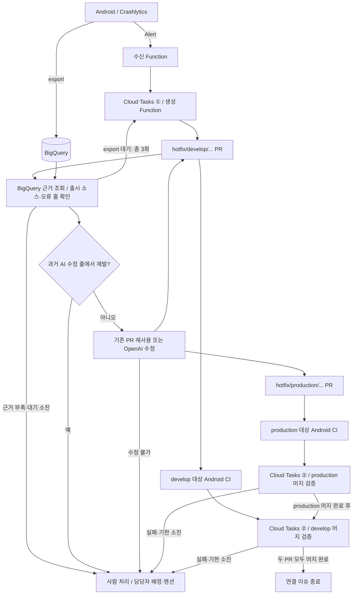

# KOIN_CRASHLYTICS_AUTOFIX

Crashlytics 오류를 이슈로 기록하고 **GPT-6.1 Sol**로 `production`·`develop` 각각의 소스에 맞는 hotfix PR을 생성합니다. **production → develop 순서로 merge commit**하며 두 PR이 완료돼야 이슈를 종료합니다. 자동 수정 불가·AI 수정 줄 재발은 사람에게 넘깁니다.

## 구조



## 준비

- Firebase **Blaze**, Android Crashlytics, BigQuery export. 행동 기록에는 Analytics 연결이 필요합니다.
- 대상 Android 저장소에 GitHub App 설치: Contents·Issues·Pull requests **쓰기**, Checks·Commit statuses·Metadata **읽기**. merge commit을 허용합니다.
- Android CI의 `Lint & Format Check`, `Code Coverage` 검사와 실제 출시 소스를 가리키는 `v<versionName>` 태그, Crashlytics R8 mapping을 준비합니다.
- 대상 브랜치 `production`, `develop`이 모두 있어야 합니다. 각 기준 SHA에서 `hotfix/<대상>/crashlytics-<hash>`를 만들며, 한쪽의 파일을 다른 쪽에 그대로 덮어쓰지 않습니다. 브랜치별 수정안은 별도 생성하고 재시도 시 기존 PR을 재사용합니다.
- GCP 배포 계정: Firebase Admin, Secret Manager Admin, Cloud Tasks Queue Admin, Service Usage Admin. 런타임·빌드 서비스 계정에는 Service Account User 권한이 필요합니다. 런타임 계정의 BigQuery 조회·Eventarc·Task 실행 권한도 별도로 준비합니다.

## GitHub Secrets

**이 저장소**의 Settings → Secrets and variables → Actions → Repository secrets에 등록합니다.

| 이름 | 값 |
| --- | --- |
| `GCP_SERVICE_ACCOUNT_KEY` | GCP 배포 서비스 계정의 JSON 키 전체 |
| `CRASHLYTICS_ENV` | 아래 환경 설정 전체 |
| `CRASHLYTICS_GITHUB_APP_PRIVATE_KEY` | GitHub App의 PEM 개인키 전체 |
| `CRASHLYTICS_OPENAI_API_KEY` | OpenAI API 키 |

배포 workflow가 GitHub Secrets를 읽고, 실행용 키 2개를 Firebase Secret Manager에 등록한 뒤 Functions를 배포합니다. 키·JSON·환경 파일은 커밋하지 않습니다.

### CRASHLYTICS_ENV

아래 값을 프로젝트에 맞게 바꿔 **Secret 값으로** 넣습니다. 따옴표 없이 `KEY=value` 형식으로 작성합니다.

```dotenv
CRASHLYTICS_PROJECT_ID=your-firebase-project-id
CRASHLYTICS_APP_ID=your-android-firebase-app-id
AUTOMATION_SERVICE_ACCOUNT=runtime@your-firebase-project-id.iam.gserviceaccount.com
BIGQUERY_LOCATION=US
CRASHLYTICS_GITHUB_APP_ID=your-github-app-id
CRASHLYTICS_GITHUB_INSTALLATION_ID=your-installation-id
CRASHLYTICS_AUTOFIX_BOT_LOGIN=bcsd-b-bot[bot]
AUTOFIX_GITHUB_REPOSITORY=owner/android-repository
CRASHLYTICS_BUNDLE_ID=your.android.package
BIGQUERY_TABLE=your-package_ANDROID
OPENAI_MODEL=gpt-6.1-sol
```

BigQuery dataset은 `firebase_crashlytics`, 위치는 실제 dataset 위치, 테이블은 `_REALTIME`을 제외한 기본 이름을 사용합니다. 봇 교체 시 `CRASHLYTICS_PRIOR_BOT_LOGINS=old-app[bot]`을 추가하면 과거 AI 수정 이력을 유지합니다. Android CI에서 봇 변수를 사용한다면 대상 저장소 변수 `CRASHLYTICS_AUTOFIX_BOT_LOGIN`도 같은 값으로 설정합니다.

## 사용법

1. 위 준비 사항과 GitHub Secrets 4개를 설정합니다.
2. `main`에 push하면 **자동 배포**합니다. 수동 배포는 Actions → **Deploy** → Run workflow → `main`을 선택합니다. 이 저장소에는 테스트·CI 작업이 없으며 배포 workflow만 있습니다.
3. **stage 앱**에서 실제 crash로 Alert → 이슈 → PR → CI → 머지를 확인합니다. APK/AAB 배포는 별도입니다.

생성 작업은 6시간 간격 **총 3회**, 머지는 CI·SHA·manifest·파일 해시를 검증하며 최대 약 7일 대기합니다. 이슈에 기기 정보·안전한 최근 행동·추정 재현 경로를 기록합니다. GitHub 보호 규칙은 우회하지 않습니다.

